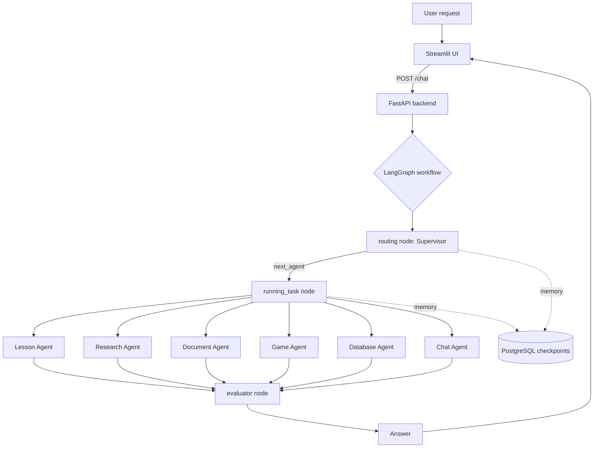

# Tech AI — Multi-Agent Teacher Assistant

> An AI teaching assistant built with a supervisor + specialist multi-agent graph. It writes lessons, creates study documents, builds learning games, researches facts on the web and stores progress in a database.


## What It Does

You send one request. A **supervisor agent** reads it, splits it into topics and picks the right specialist agents. Each specialist then does its part.

| Agent | Responsibility |
|---|---|
| **Supervisor** | Understands the request, splits it into topics, assigns tasks. Uses vision tools for images and search tools to clarify unknown terms. |
| **Lesson Agent** | Explains topics step by step, with examples and exercises, at the right level. |
| **Research Agent** | Searches the web, checks facts and returns sources. |
| **Document Agent** | Writes summaries, notes, reports and quizzes as DOCX, XLSX or PPTX files. |
| **Game Agent** | Builds quizzes, flashcards, matching and other learning games. |
| **Database Agent** | Reads and writes user profiles, progress, scores and saved material. |
| **Chat Agent** | Handles greetings and small talk. |

## Architecture



The graph has three nodes:

1. **`routing`** — calls the supervisor, which returns `next_agent` and a list of `agent_task` items.
2. **`running_task`** — sends the planned task to the chosen specialist agent and stores its answer.
3. **`evaluator`** — marks the answer as approved and ends the run.

Conversation memory is stored in PostgreSQL through a LangGraph checkpointer, so a follow-up question in the same `session_id` keeps context.

## Tech Stack

| Layer | Technology |
|---|---|
| Agent framework | LangGraph (StateGraph), LangChain agents |
| LLMs | Google Gemini, Groq, OpenRouter, Ollama (local) |
| Backend API | FastAPI, Uvicorn |
| Frontend | Streamlit |
| Memory / data | PostgreSQL, LangGraph Postgres checkpointer |
| Vector store | Qdrant (optional, for RAG) |
| Documents | python-docx, openpyxl, python-pptx |
| Web search | DuckDuckGo, Tavily |
| Vision | OpenCV, cvzone (lazy-loaded) |
| Packaging | Docker, docker-compose |

## Quick Start

### Option A — Docker (recommended)

```bash
git clone https://github.com/dastonbek8747/tech-ai-teacher-assistant.git
cd tech-ai-teacher-assistant
cp .env.example .env      # then add your LLM keys
docker compose up --build
```

- Backend API: http://localhost:8000
- Streamlit UI: http://localhost:8501
- Qdrant: http://localhost:6333

### Option B — local Python

```bash
python -m venv .venv && source .venv/bin/activate
pip install -r backend/requirements.txt
pip install -r frontend/requirements.txt
cp .env.example .env

# terminal 1
uvicorn backend.main:app --reload

# terminal 2
API_URL=http://localhost:8000 streamlit run frontend/app.py
```

### Environment variables (`.env`)

| Variable | Meaning |
|---|---|
| `DATABASE_URL` | PostgreSQL URL for the database agent and the checkpointer. |
| `POSTGRES_ADMIN_URL` | Optional. Used only to create new databases. |
| `GEMINI_API_KEY` | Google Gemini API key. |
| `GROQ_API_KEY` | Groq API key. |
| `OPENROUTER_API_KEY` | OpenRouter API key. |
| `TAVILY_SEARCH_API_KEY` | Optional. Better web search. |
| `QDRANT_URL` | Optional. Qdrant vector store URL. |

At least one LLM provider key is required.

## API

| Method | Path | Description |
|---|---|---|
| `GET` | `/` | Service info. |
| `GET` | `/health` | Health check. |
| `POST` | `/chat` | Run one request through the agent graph. |
| `GET` | `/creating_files/{file}` | Download a file created by the Document Agent. |

**Request**

```json
{
  "request": "Explain Present Simple for beginners, then make a 10-question quiz",
  "session_id": "user-123"
}
```

**Response**

```json
{
  "next_agent": "lesson_agent",
  "answer": "Present Simple is used for habits and facts..."
}
```

## Example Usage

> **Example prompts.** Run the app with your own LLM key to see real answers.

| Prompt | Agents involved |
|---|---|
| `Explain Present Simple for beginners, then make a 10-question quiz` | Supervisor → Lesson → Game |
| `Write study notes about photosynthesis and the water cycle` | Supervisor → Research ×2 → Document ×2 |
| `Find the latest facts about the James Webb telescope` | Supervisor → Research |
| `Save my quiz score` | Supervisor → Database |
| `Salom` | Supervisor → Chat |

## Project Structure

```
tech-ai-teacher-assistant/
├── backend/
│   ├── main.py                # FastAPI app and /chat route
│   ├── agents/                # supervisor + specialist agents
│   ├── graph/
│   │   ├── nodes.py           # routing, running_task, evaluator, build_graph
│   │   └── states.py          # GeneralStates TypedDict
│   ├── llm/llm.py             # lazy LLM factory (Gemini, Groq, OpenRouter, Ollama)
│   ├── prompts/               # one prompt file per agent
│   ├── tools/                 # db, search, vision, file toolkits
│   └── requirements.txt
├── frontend/app.py            # Streamlit chat UI
├── tests/test_graph.py        # pytest suite (no LLM calls)
├── docker-compose.yml
├── requirements-ci.txt        # lightweight deps for CI
└── .env.example
```

## Safety and Reliability

- **Import-safe modules** — every LLM and every database engine is created lazily. Importing the code never needs an API key or a live database.
- **Clean API errors** — an agent failure returns a clear `500` message instead of a raw traceback.
- **No committed secrets** — `.env` is ignored; `.env.example` shows the required keys.
- **Prompt-level safety** — the supervisor refuses to plan harmful or illegal content.
- **Plan limits** — the supervisor produces at most 5 topics and 20 tasks per request.

## What I Learned / Design Decisions

- **Why a supervisor + specialists** — one model trying to teach, research and write files at once gets confused. Splitting the work keeps each agent focused and easier to test.
- **Why LangGraph** — the graph makes the control flow explicit and easy to extend with retries or parallel branches.
- **Why lazy imports** — the project mixes heavy native libraries (OpenCV, face recognition) with LLM clients. Lazy loading keeps the code importable and testable without them.
- **Why a checkpointer** — storing memory in PostgreSQL means a conversation survives a restart.

## Roadmap

- [ ] Retry logic in the evaluator node using `retry_count` / `max_retry_count`.
- [ ] Run independent topic tasks in parallel.
- [ ] Authentication and per-user sessions.
- [ ] Record a demo GIF in `docs/`.
- [ ] Add a RAG pipeline over uploaded PDFs with Qdrant.

## License

MIT © 2026 Doston Sultonov. See [LICENSE](LICENSE).
